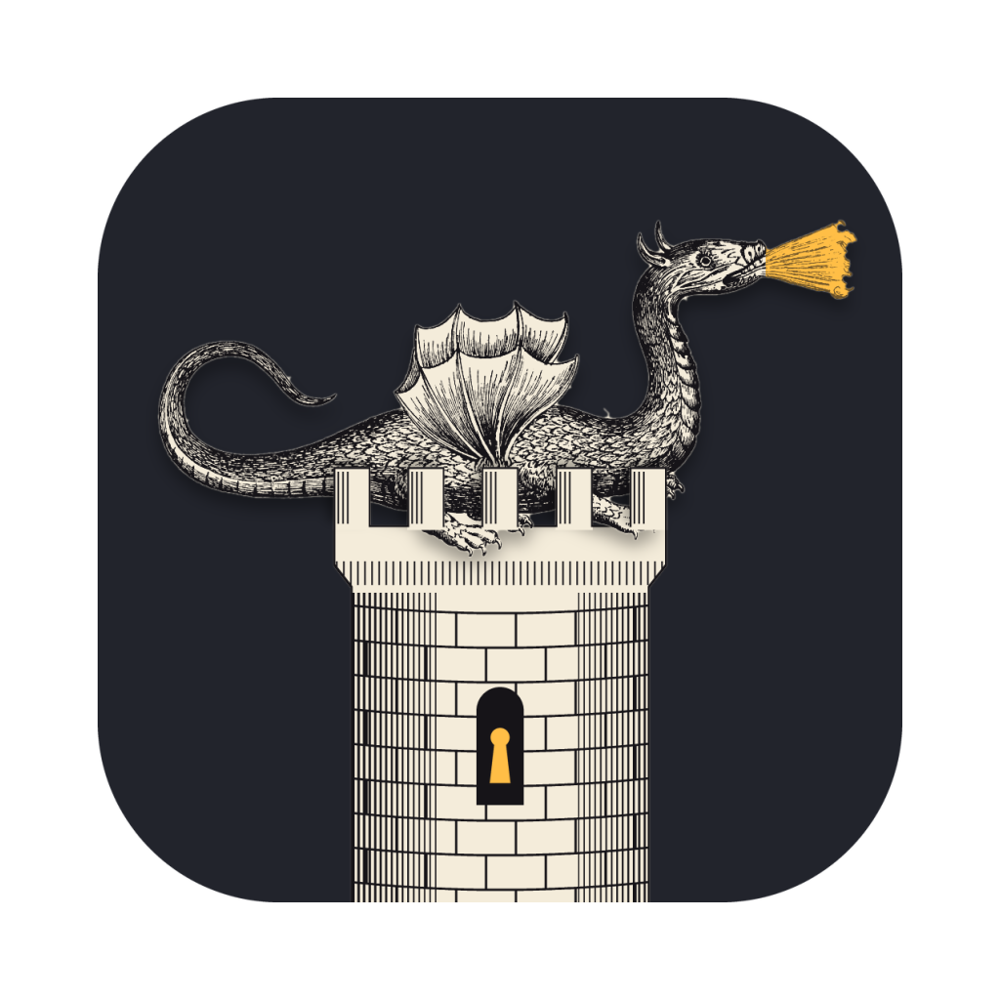
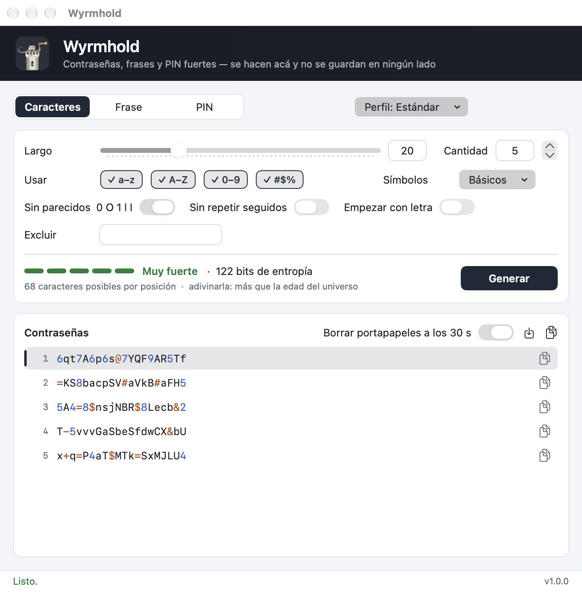
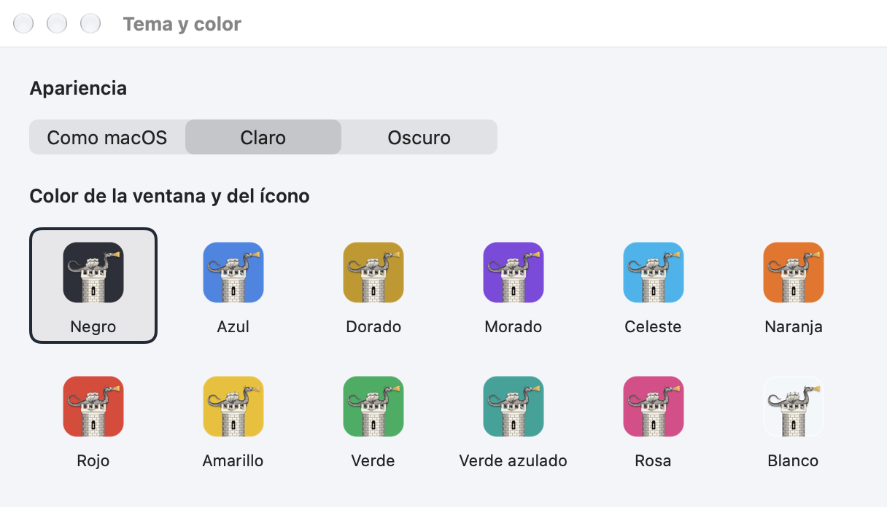

<p align="center"></p>

<h1 align="center">Wyrmhold</h1>
<p align="center"><b>Contraseñas, frases y PIN fuertes — se hacen en tu computadora y no se guardan en ningún lado.</b></p>

Gabriel Castiglia · 10 de noviembre de 2026 · versión 1.0.0 · GPL-2.0-only

[English](README.md) · Español · [日本語](README.ja.md)

Versión para Windows: <https://github.com/Gabriel-Castiglia/wyrmhold-windows>

Manual en PDF: [`docs/Wyrmhold-manual-es.pdf`](docs/Wyrmhold-manual-es.pdf)

> Solo para macOS 15 o posterior en Apple silicon (arm64). No hay versión para Mac con procesador Intel.

Wyrmhold genera contraseñas, frases de contraseña y PIN fuertes y al azar en tu Mac: para un zip o 7z que se
manda por email, una cuenta nueva, una red Wi-Fi o una cerradura. No guarda ni envía nada; las contraseñas
existen solo en la ventana hasta que las copiás o guardás. La interfaz está en español, inglés y japonés.

*Wyrm* es dragón en inglés antiguo, y *hold* una fortaleza: un wyrmhold es el reducto donde un dragón cuida su
tesoro. El ícono es el dragón alado de Athanasius Kircher (*Mundus Subterraneus*, 1665) echado sobre su torre.



## Requisitos

- macOS 15 o posterior en una Mac con Apple silicon. Probado en macOS 27.2.
- Para compilarlo: las Command Line Tools de Apple (`xcode-select --install`). Xcode no hace falta.

## Instalación

Bajá `Wyrmhold-<versión>.pkg` de la [página de versiones](https://github.com/Gabriel-Castiglia/wyrmhold/releases/latest)
y abrilo. El instalador está en español, inglés o japonés, según el idioma de la Mac. Pone `Wyrmhold.app` en
`/Applications` y, si había una copia abierta, la cierra antes; instalar un paquete más nuevo conserva la
configuración.

El paquete no está firmado con un Developer ID de Apple, así que la primera vez macOS no lo abre («Apple no
pudo verificar…»). Abrí Configuración del Sistema → Privacidad y seguridad, bajá hasta el aviso sobre
`Wyrmhold-<versión>.pkg`, hacé clic en Abrir igualmente y confirmá. Con el archivo `SHA256SUMS.txt` de cada
versión podés comprobar la descarga antes:

```
shasum -a 256 Wyrmhold-1.0.0.pkg
```

Para desinstalarlo, cerrá Wyrmhold, arrastrá `/Applications/Wyrmhold.app` a la papelera y, si querés borrar
también la configuración, corré `defaults delete io.github.gabriel-castiglia.wyrmhold`.

## Uso

La primera vez, Wyrmhold abre en el idioma de la Mac si es español o japonés, y en inglés si no; el menú Idioma
lo cambia en cualquier momento.

1. Elegí el tipo arriba: Caracteres, Frase o PIN (⌘1, ⌘2, ⌘3). Al lado, el menú Perfil trae configuraciones
   listas.
2. Ajustá las opciones. Cada cambio genera un juego nuevo al instante; Generar (⌘R) hace otro.
3. La línea de fuerza muestra una barra de cinco pasos, la entropía en bits, cuántos caracteres puede tomar
   cada posición y cuánto llevaría adivinarla.
4. La lista muestra hasta 50 contraseñas. Los dígitos van en azul y los símbolos en ámbar, para releer o
   dictar más fácil; lo que se copia es texto común.

Para copiar una, hacé clic en el botón de copiar al final de su fila, doble clic en la fila, o elegila con las
flechas y apretá Intro o ⌘C. ⇧⌘C copia todas, una por línea; ⌘S las guarda en un archivo de texto que solo tu
usuario puede leer.

### Los tres tipos

Los caracteres (4 a 128) son lo más fuerte para su largo y convienen cuando la contraseña se pega en vez de
tipearse. Elegís qué tipos usar (a–z, A–Z, 0–9, símbolos) y qué símbolos: Básicos (`! @ # $ % & * + - = ?`),
Los 32, Mínimos (`- _ .`) o Los míos. Las opciones son Sin parecidos (saca `0 O 1 l I` y, entre los símbolos,
la barra, el acento grave y las dos comillas), Sin repetir seguidos, Empezar con letra, y Excluir para cualquier
otro carácter. Cada tipo encendido aparece al menos una vez. Una frase (3 a 12 palabras) toma palabras al azar
de la lista EFF de 7776, como `Copper-Showroom-Wrecking7-Salute`: es más larga, pero mucho más fácil de recordar
o de tipear en un teléfono. Seis palabras dan unos 80 bits. Un PIN son solo dígitos, con la opción de no
repetir vecinos ni hacer seguidillas como 123 o 987; es seguro solo donde los intentos fallidos están
limitados, como en tarjetas, teléfonos y cerraduras.

### Perfiles

Estándar (20 caracteres, símbolos básicos), Máxima (32, todos los símbolos), Sin símbolos, Símbolos mínimos,
Corta (12, para un largo máximo bajo), Wi-Fi (fácil de tipear en un teléfono o un televisor), Frase (6
palabras) y PIN (6 dígitos, sin repetir ni seguidillas). Cuando un sitio no acepta algunos caracteres: elegí Sin
símbolos, o Símbolos → Mínimos, o Los míos con exactamente los símbolos que lista el sitio, o escribí los
rechazados en Excluir.

### Tema y color

Wyrmhold → Tema y color… (⌘,) elige la apariencia (como macOS, claro u oscuro) y uno de doce colores. El color
tiñe la franja de la ventana, los botones y el ícono en el Dock; el negro es el de fábrica. El ícono en el
Finder y en Launchpad sigue negro, porque cambiarlo rompería la firma de la app.



## Cómo se hacen las contraseñas

El motor es el código C de la versión para Windows, compilado dentro de la app sin cambios salvo la fuente de
números aleatorios: acá `arc4random_buf`, el generador criptográfico de macOS, alimentado por el núcleo. Cada
carácter o palabra se sortea por rechazo, así que todos son exactamente igual de probables. Cuando una
contraseña no cumple alguna regla (falta un tipo de carácter, un vecino repetido, una seguidilla como 123) se
descarta entera y se sortea de nuevo, nunca se parcha. El resultado es uniforme entre todas las contraseñas que
cumplen las reglas.

La entropía se cuenta exactamente, por programación dinámica sobre las posiciones, con todas las reglas: n bits
son 2^n contraseñas posibles. Menos de 50 bits es débil, 64 aceptable, 80 o más muy fuerte. El tiempo para
adivinarla supone un atacante que tiene el archivo y prueba 100 mil millones de contraseñas por segundo. Con lo
predeterminado (20 caracteres) son unos 122 bits.

## Portapapeles

Cada copia es solo para esta Mac, así que el Portapapeles Universal nunca la pasa a tus otros dispositivos, y va
marcada `org.nspasteboard.ConcealedType`, que los gestores de portapapeles respetan dejándola fuera de su
historial. Con «Borrar portapapeles a los 30 s» encendido, una contraseña copiada se borra 30 segundos después,
o al cerrar Wyrmhold, salvo que se haya copiado otra cosa mientras tanto.

## Configuración

Se guarda en `~/Library/Preferences/io.github.gabriel-castiglia.wyrmhold.plist`, con los mismos nombres que usa
la versión para Windows. La app nunca escribe las contraseñas en ningún lado.

## Línea de comandos

El programa que está dentro de la app también escribe contraseñas en un archivo sin abrir ventana, con las
opciones de la versión para Windows escritas con guion:

```
W=/Applications/Wyrmhold.app/Contents/MacOS/Wyrmhold
$W -out:contraseñas.txt -count:10
$W -out:frases.txt -mode:words -words:7 -sep:space
$W -entropy:bits.txt -len:16 -classes:lud
```

| Opción | Qué hace |
|---|---|
| `-out:ARCHIVO` | escribe las contraseñas, una por línea (el archivo lo puede leer solo tu usuario) |
| `-entropy:ARCHIVO` | escribe `bits pool check` de la configuración |
| `-count:N` | cuántas (5 por defecto, hasta 100.000) |
| `-mode:chars\|words\|pin` | el tipo |
| `-len:N`, `-words:N` | largo, o cantidad de palabras |
| `-classes:luds` | minúsculas, mayúsculas, dígitos, símbolos |
| `-symbols:basic\|all\|min\|custom:LISTA` | el juego de símbolos |
| `-exclude:LISTA` | caracteres a excluir |
| `-ambiguous` | permite los caracteres que se parecen |
| `-norepeat`, `-startletter` | sin repetir seguidos; empezar con letra |
| `-sep:hyphen\|space\|dot\|underscore\|none\|digit` | separador entre palabras |
| `-nocap`, `-nonumber` | frase sin mayúsculas, sin el dígito |
| `-allowruns` | PIN con seguidillas como 123 |
| `-preset:N` | un perfil, de 0 a 7, en el orden del menú Perfil |

Sin opciones sigue el perfil Estándar, diga lo que diga la configuración de la app. Códigos de salida: 0 listo,
2 no se pudo escribir el archivo, 3 no se pudo sortear ninguna contraseña, 5 con esas opciones no hay contraseña
posible.

## Compilar

```
git clone https://github.com/Gabriel-Castiglia/wyrmhold.git
cd wyrmhold
scripts/compilar.sh          # build/Wyrmhold.app
scripts/paquete.sh           # build/Wyrmhold-<versión>.pkg
```

`compilar.sh` firma la app con un certificado propio guardado en su propio llavero, que crea la primera vez,
para que macOS vea la misma app de una compilación a otra. `FIRMA=adhoc scripts/compilar.sh` la firma sin ese
certificado, para una prueba rápida. La versión se escribe solo en `scripts/compilar.sh`.

Las pruebas:

```
B=build/Wyrmhold.app/Contents/MacOS/Wyrmhold
$B --self-test                                  # textos, ícono, perfiles, lista, portapapeles
python3 tools/check_options.py $B               # cada opción contra una cuenta hecha en Python
$B -out:/tmp/p.txt -count:100000 && python3 tools/check_passwords.py /tmp/p.txt 20 1 100000
```

`check_options.py` le pide al programa contraseñas y su entropía en trece configuraciones, y compara cada
contraseña con las reglas y cada entropía con una cuenta hecha por separado, por fuerza bruta o
inclusión-exclusión. `check_passwords.py` revisa 100.000 contraseñas estándar y que sus caracteres salgan
parejos (chi cuadrado).

`scripts/manual.sh` hace los manuales PDF a partir de los tres README, y `scripts/capturas.sh` las imágenes de
`docs/img`. `tools/make_icon.py` dibuja el ícono (`icono/icono-1024.png`) y la capa que la app tiñe
(`assets/icon_layer.wyi`); necesita Python con numpy, opencv-python, scipy y Pillow.

Las herramientas con que se compiló y probó Wyrmhold 1.0.0 están en la tabla del
[README en inglés](README.md#building-from-source).

## Estructura

| Carpeta | Contenido |
|---|---|
| `Sources/` | La app (Swift, AppKit y SwiftUI) |
| `Sources/Engine/` | El motor de contraseñas en C, el mismo de la versión para Windows, y la lista EFF |
| `assets/` | La lista EFF, el grabado de Kircher y la capa del ícono |
| `icono/` | El ícono de la app, 1024 px |
| `instalador/` | Las páginas y el script del paquete instalador |
| `scripts/` | Compilar, empaquetar, manuales e imágenes |
| `tools/` | Dibujo del ícono, lista de palabras y las pruebas independientes |
| `docs/` | Manuales PDF e imágenes |

## Licencia y créditos

Copyright (C) 2026 Gabriel Castiglia. Wyrmhold es software libre bajo la GNU General Public License, versión 2
únicamente (GPL-2.0-only); ver [`LICENSE`](LICENSE). Se distribuye sin ninguna garantía.

- Palabras de las frases: la [lista grande de la EFF](https://www.eff.org/dice), de la Electronic Frontier
  Foundation, bajo CC BY 3.0 US.
- Ícono: el dragón alado de Athanasius Kircher, *Mundus Subterraneus* (Ámsterdam, 1665), dominio público.
