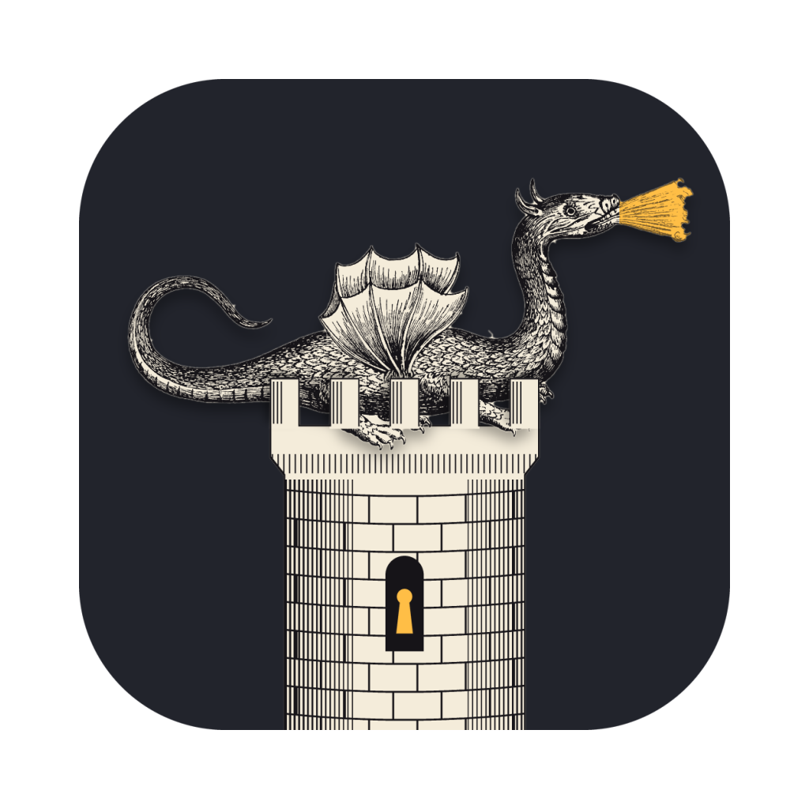
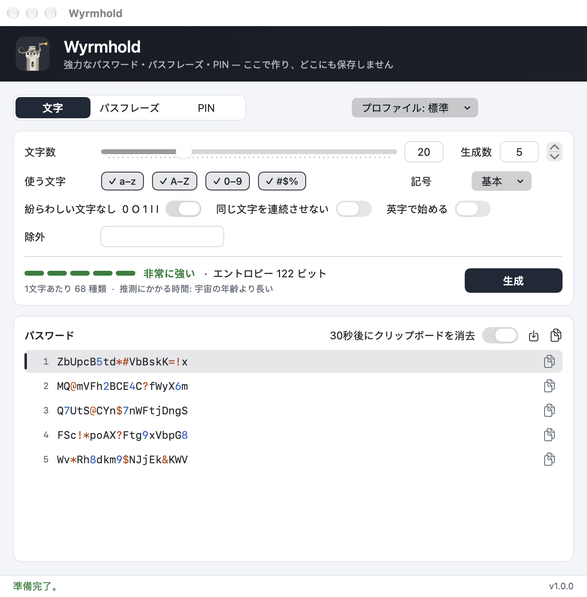
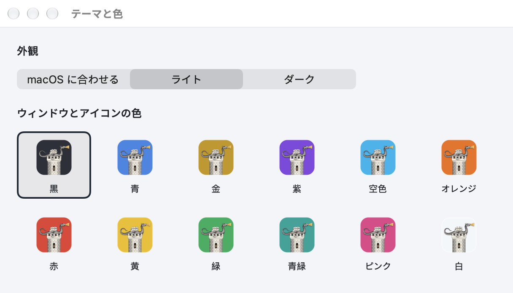

<p align="center"></p>

<h1 align="center">Wyrmhold</h1>
<p align="center"><b>強力なパスワード・パスフレーズ・PIN — このコンピューターで作り、どこにも保存しません。</b></p>

Gabriel Castiglia · 2026年11月10日 · バージョン 1.0.0 · GPL-2.0-only

[English](README.md) · [Español](README.es.md) · 日本語

Windows 版: <https://github.com/Gabriel-Castiglia/wyrmhold-windows>

PDF マニュアル: [`docs/Wyrmhold-manual-ja.pdf`](docs/Wyrmhold-manual-ja.pdf)

> Apple シリコン (arm64) 搭載の macOS 15 以降専用です。Intel プロセッサ搭載の Mac 用はありません。

Wyrmhold は、強力なランダムパスワード、パスフレーズ、PIN をお使いの Mac の中で作ります。メールで送る zip や 7z ファイル、新しいアカウント、Wi-Fi、錠前などに使えます。何も保存されず、どこにも送信されません。パスワードは、コピーまたは保存するまでウィンドウの中にだけ存在します。画面は日本語、英語、スペイン語に対応しています。

*Wyrm* は古英語で「竜」、*hold* は「砦」。wyrmhold は竜が宝を守る砦のことです。アイコンは、アタナシウス・キルヒャー『地下世界』(1665 年)の翼のある竜が塔の上に横たわる姿です。



## 動作環境

- Apple シリコン搭載 Mac の macOS 15 以降。macOS 27.2 で確認しています。
- ソースからビルドする場合: Apple の Command Line Tools (`xcode-select --install`)。Xcode は不要です。

## インストール

[リリースページ](https://github.com/Gabriel-Castiglia/wyrmhold/releases/latest)から `Wyrmhold-<バージョン>.pkg` をダウンロードして開きます。インストーラは Mac の言語に合わせて日本語、英語、スペイン語で表示されます。`Wyrmhold.app` を `/Applications` に入れ、実行中のものがあれば先に終了させます。新しいパッケージをインストールしても設定はそのまま残ります。

パッケージは Apple の Developer ID で署名されていないため、初回は macOS が開くのを拒みます(「Apple は検証できませんでした…」)。「システム設定」→「プライバシーとセキュリティ」を開き、`Wyrmhold-<バージョン>.pkg` についてのメッセージまでスクロールして「このまま開く」をクリックし、確認します。各リリースの `SHA256SUMS.txt` で、先にダウンロードを確認できます:

```
shasum -a 256 Wyrmhold-1.0.0.pkg
```

アンインストールするには、Wyrmhold を終了して `/Applications/Wyrmhold.app` をゴミ箱に入れます。設定も消す場合は `defaults delete io.github.gabriel-castiglia.wyrmhold` を実行します。

## 使い方

初回は、Mac の言語が日本語かスペイン語ならその言語で、それ以外なら英語で起動します。「言語」メニューでいつでも切り替えられます。

1. 上部で種類を選びます: 文字、パスフレーズ、PIN (⌘1、⌘2、⌘3)。その横の「プロファイル」メニューに用意された設定があります。
2. 設定を調整します。変えるたびに新しいパスワードが作られ、「生成」(⌘R) でさらに作れます。
3. 強度の行には、5 段階のバー、エントロピー(ビット)、1 文字あたりの候補数、推測にかかる時間が表示されます。
4. 一覧には最大 50 個のパスワードが表示されます。数字は青、記号はオレンジで表示され、読み返しや読み上げが楽になります。コピーされるのは普通のテキストです。

1 つをコピーするには、行の右端のコピーボタンをクリック、行をダブルクリック、または矢印キーで選んで return か ⌘C を押します。⇧⌘C ですべてを 1 行に 1 つずつコピーし、⌘S で自分のユーザーだけが読めるテキストファイルに保存します。

### 3 つの種類

文字(4〜128)は長さあたり最も強力で、入力せず貼り付けて使うパスワードに向いています。使う種類(a–z、A–Z、0–9、記号)と記号のセットを選びます: 基本(`! @ # $ % & * + - = ?`)、全32種、最小限(`- _ .`)、自分で指定。オプションは「紛らわしい文字なし」(`0 O 1 l I` と、記号のうち縦線、バッククォート、引用符 2 種を除く)、「同じ文字を連続させない」、「英字で始める」、そしてほかの文字を除く「除外」です。オンにした種類は必ず 1 回以上入ります。パスフレーズ(3〜12 単語)はEFF の 7776 語のリストからランダムな単語を選びます(例: `Copper-Showroom-Wrecking7-Salute`)。長くなりますが、覚えたりスマホで入力したりするのがずっと楽です。6 単語で約 80 ビットです。PIN は数字のみで、同じ数字の連続や123・987 のような連番をなくすこともできます。カード、スマホ、錠前のように誤入力の回数が制限される場合にだけ安全です。

### プロファイル

標準(20 文字、基本の記号)、最強(32 文字、すべての記号)、記号なし、最小限の記号、短め(12 文字、最大文字数が短いサイト向け)、Wi-Fi(スマホやテレビで入力しやすい)、パスフレーズ(6 単語)、PIN(6 桁、連続・連番なし)。サイトが一部の文字を受け付けない場合は、「記号なし」、「記号」→「最小限」、サイトが示す記号だけを入れた「自分で指定」のいずれかを選ぶか、受け付けない文字を「除外」に入力します。

### テーマと色

「Wyrmhold」→「テーマと色…」(⌘,) で、外観(macOS に合わせる、ライト、ダーク)と 12 色から 1 色を選びます。色はウィンドウの帯、ボタン、Dock のアイコンに使われます(既定は黒)。Finder と Launchpad のアイコンは黒のままです。変えるとアプリの署名が壊れるためです。



## パスワードの作り方

エンジンは Windows 版の C コードで、乱数の取り出し元だけを変えてそのままアプリに組み込んでいます。Mac では、カーネルが供給する macOS の暗号用乱数生成器 `arc4random_buf` を使います。各文字や単語は棄却サンプリングで選ぶので、どれもまったく同じ確率です。規則に合わないパスワード(必要な種類がない、同じ文字の連続、123 のような連番など)は修正せず、まるごと捨てて引き直します。その結果、規則を満たすすべてのパスワードが均等に出ます。

エントロピーは、すべての規則を含めて、位置ごとの動的計画法で正確に数えます。n ビットは 2^n 通りのパスワードを意味します。50 ビット未満は弱く、64 ビットで普通、80 ビット以上で非常に強力です。推測時間は、ファイルを入手した攻撃者が毎秒 1000 億回試す場合の目安です。初期設定(20 文字)で約 122 ビットです。

## クリップボード

コピーはこの Mac 専用なので、ユニバーサルクリップボードでほかのデバイスに送られることはありません。また `org.nspasteboard.ConcealedType` の印が付くので、クリップボード管理アプリは履歴に残しません。「30秒後にクリップボードを消去」がオンのとき、コピーしたパスワードは 30 秒後、または Wyrmhold を終了したときに消去されます(その間にほかのものをコピーした場合を除く)。

## 設定

設定は `~/Library/Preferences/io.github.gabriel-castiglia.wyrmhold.plist` に、Windows 版と同じ名前で保存されます。アプリがパスワードをどこかに書き込むことはありません。

## コマンドライン

アプリの中のプログラムは、ウィンドウを開かずにパスワードをファイルに書き出すこともできます。スイッチは Windows 版と同じで、ハイフンで書きます:

```
W=/Applications/Wyrmhold.app/Contents/MacOS/Wyrmhold
$W -out:passwords.txt -count:10
$W -out:phrases.txt -mode:words -words:7 -sep:space
$W -entropy:bits.txt -len:16 -classes:lud
```

| スイッチ | 意味 |
|---|---|
| `-out:ファイル` | パスワードを 1 行に 1 つ書き出す(ファイルは自分のユーザーだけが読める) |
| `-entropy:ファイル` | 設定の `bits pool check` を書き出す |
| `-count:N` | 個数(既定 5、最大 100,000) |
| `-mode:chars\|words\|pin` | 種類 |
| `-len:N`、`-words:N` | 長さ、または単語数 |
| `-classes:luds` | 小文字、大文字、数字、記号 |
| `-symbols:basic\|all\|min\|custom:リスト` | 記号のセット |
| `-exclude:リスト` | 除外する文字 |
| `-ambiguous` | 紛らわしい文字を許可 |
| `-norepeat`、`-startletter` | 同じ文字を連続させない、英字で始める |
| `-sep:hyphen\|space\|dot\|underscore\|none\|digit` | 単語の区切り |
| `-nocap`、`-nonumber` | 大文字なし、数字なしのパスフレーズ |
| `-allowruns` | 123 のような連番を PIN に許可 |
| `-preset:N` | プロファイル(0〜7、「プロファイル」メニューの順) |

オプションがなければ、アプリの設定に関係なく「標準」プロファイルに従います。終了コード: 0 完了、2 ファイルに書き込めない、3 パスワードを引けなかった、5 その設定ではパスワードを作れない。

## ビルド

```
git clone https://github.com/Gabriel-Castiglia/wyrmhold.git
cd wyrmhold
scripts/compilar.sh          # build/Wyrmhold.app
scripts/paquete.sh           # build/Wyrmhold-<バージョン>.pkg
```

`compilar.sh` は、初回に作る専用のキーチェーンに入れた自己発行の証明書でアプリに署名します。こうすると、ビルドを繰り返しても macOS は同じアプリとして扱います。`FIRMA=adhoc scripts/compilar.sh` はその証明書を使わずに署名し、手早く試すためのものです。バージョンは `scripts/compilar.sh` にだけ書きます。

テスト:

```
B=build/Wyrmhold.app/Contents/MacOS/Wyrmhold
$B --self-test                                  # 文字列表、アイコン、プロファイル、一覧、クリップボード
python3 tools/check_options.py $B               # 各オプションを Python で数えた値と照合
$B -out:/tmp/p.txt -count:100000 && python3 tools/check_passwords.py /tmp/p.txt 20 1 100000
```

`check_options.py` は 13 の設定でパスワードとエントロピーをプログラムに求め、各パスワードを規則と、各エントロピーを総当たりまたは包除原理で別に数えた値と照合します。`check_passwords.py` は標準のパスワード 100,000 個と、文字の出方の偏り(カイ二乗)を調べます。

`scripts/manual.sh` は 3 つの README から PDF マニュアルを作り、`scripts/capturas.sh` は `docs/img` の画像を作ります。`tools/make_icon.py` はアイコン(`icono/icono-1024.png`)とアプリが色を付けるレイヤー(`assets/icon_layer.wyi`)を描きます。numpy、opencv-python、scipy、Pillow を入れた Python が必要です。

Wyrmhold 1.0.0 のビルドと確認に使ったツールのバージョンは、[英語の README](README.md#building-from-source) の表にあります。

## 構成

| パス | 内容 |
|---|---|
| `Sources/` | アプリ本体(Swift、AppKit、SwiftUI) |
| `Sources/Engine/` | Windows 版と共通の C のパスワードエンジンと EFF の単語リスト |
| `assets/` | EFF の単語リスト、キルヒャーの版画、アイコンのレイヤー |
| `icono/` | アプリのアイコン(1024 px) |
| `instalador/` | インストーラパッケージのページとスクリプト |
| `scripts/` | ビルド、パッケージ、マニュアル、画像 |
| `tools/` | アイコンの描画、単語リスト、独立したテスト |
| `docs/` | PDF マニュアルと画像 |

## ライセンスとクレジット

Copyright (C) 2026 Gabriel Castiglia. Wyrmhold は GNU 一般公衆利用許諾書 第2版のみ(GPL-2.0-only)のもとで配布されるフリーソフトウェアです。[`LICENSE`](LICENSE) を参照してください。無保証です。

- パスフレーズの単語: Electronic Frontier Foundation の [EFF large word list](https://www.eff.org/dice)(CC BY 3.0 US)。
- アイコン: アタナシウス・キルヒャー『地下世界』(アムステルダム、1665 年)の翼のある竜(パブリックドメイン)。
