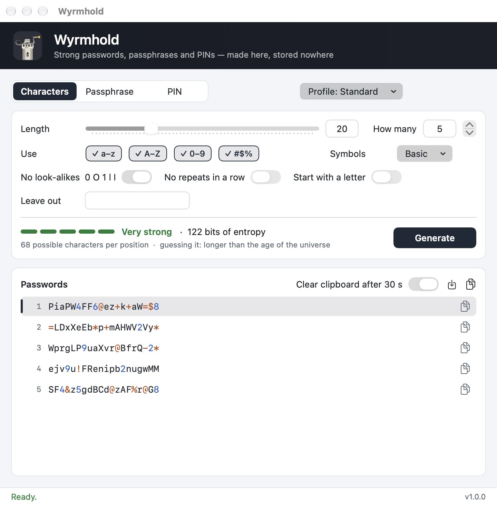
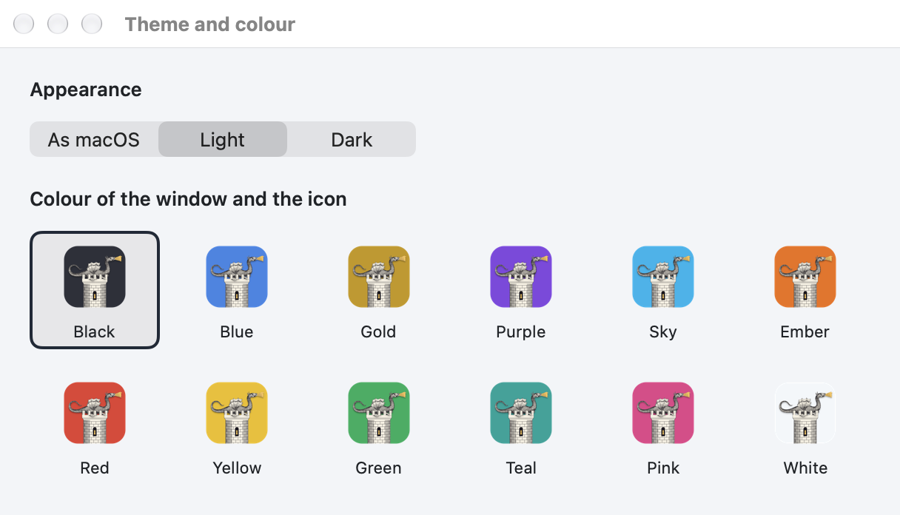

# Wyrmhold

Gabriel Castiglia · November 10, 2026 · version 1.0.0 · GPL-2.0-only

English · [Español](README.es.md) · [日本語](README.ja.md)

Repository: <https://github.com/Gabriel-Castiglia/wyrmhold>

Windows version: <https://github.com/Gabriel-Castiglia/wyrmhold-windows>

PDF manual: [`docs/Wyrmhold-manual-en.pdf`](docs/Wyrmhold-manual-en.pdf)

> macOS 15 or later on Apple silicon (arm64) only. There is no build for Macs with an Intel processor.

Wyrmhold makes strong random passwords, passphrases and PINs on your Mac: for a zip or 7z file sent by email,
a new account, a Wi-Fi network or a lock. Nothing is stored or sent anywhere; the passwords exist only in the
window until you copy or save them. The interface is in English, Japanese and Spanish.

*Wyrm* is the Old English word for dragon, and *hold* a stronghold: a wyrmhold is the dragon's keep, where a
dragon guards its hoard. The icon is Athanasius Kircher's winged dragon (*Mundus Subterraneus*, 1665) lying on
its tower.



## Requirements

- macOS 15 or later on a Mac with Apple silicon. Tested on macOS 27.2.
- To build from source: Apple's Command Line Tools (`xcode-select --install`). Xcode is not needed.

## Installation

Download `Wyrmhold-<version>.pkg` from the
[releases page](https://github.com/Gabriel-Castiglia/wyrmhold/releases) and open it. The installer speaks
English, Japanese or Spanish, following the language of the Mac. It puts `Wyrmhold.app` in `/Applications`,
closing a running copy first; installing a newer package keeps the settings.

The package is not signed with an Apple Developer ID, so the first time macOS refuses to open it ("Apple
could not verify…"). Open System Settings → Privacy & Security, scroll to the message about
`Wyrmhold-<version>.pkg`, click Open Anyway and confirm. The `SHA256SUMS.txt` file of each release lets you
check the download first:

```
shasum -a 256 Wyrmhold-1.0.0.pkg
```

To uninstall, quit Wyrmhold, drag `/Applications/Wyrmhold.app` to the Trash and, to remove the settings too,
run `defaults delete io.github.gabriel-castiglia.wyrmhold`.

## Using it

The first time, Wyrmhold opens in the language of the Mac if it is Japanese or Spanish, and in English
otherwise; the Language menu changes it at any moment.

1. Choose the kind at the top: Characters, Passphrase or PIN (⌘1, ⌘2, ⌘3). Next to it, the Profile menu
   holds ready-made settings.
2. Adjust the settings. Every change makes a new set at once; Generate (⌘R) makes another.
3. The strength line shows a five-step bar, the entropy in bits, how many characters each position can take
   and how long guessing would take.
4. The list shows up to 50 passwords. Digits are blue and symbols amber, so a password is easier to read back
   or dictate; what is copied is plain text.

To copy one password, click the copy button at the end of its row, double-click the row, or select it with
the arrow keys and press Return or ⌘C. ⇧⌘C copies them all, one per line; ⌘S saves them to a text file that
only your user can read.

### The three kinds

Characters (4 to 128) are the strongest for their length and suit passwords that are
pasted rather than typed. Choose which kinds to use (a–z, A–Z, 0–9, symbols) and which symbols: Basic
(`! @ # $ % & * + - = ?`), All 32, Minimal (`- _ .`) or My own. The options are No look-alikes (leaves out
`0 O 1 l I`, and among the symbols the bar, the backquote and both quotes), No repeats in a row, Start with a letter, and Leave out for any other character.
Every kind that is on appears at least once. A passphrase (3 to 12 words) takes random words from the EFF
list of 7,776, such as `Copper-Showroom-Wrecking7-Salute`: longer, but far easier to remember or type on a
phone. Six words give about 80 bits. A PIN is digits only, optionally with no repeated neighbours and no runs
such as 123 or 987; it is safe only where wrong tries are limited, as on cards, phones and locks.

### Profiles

Standard (20 characters, basic symbols), Maximum (32, every symbol), No symbols, Minimal symbols,
Short (12, for a low maximum), Wi-Fi (easy to type on a phone or a TV), Passphrase (6 words) and PIN (6 digits,
no repeats or runs). When a site refuses some characters: choose No symbols, or Symbols → Minimal, or My own
with exactly the symbols the site lists, or type the refused characters in Leave out.

### Theme and colour

Wyrmhold → Theme and colour… (⌘,) chooses the appearance (as macOS, light or dark) and
one of twelve colours. The colour tints the window band, the buttons and the icon in the Dock; black is the
default. The icon in Finder and Launchpad stays black, because changing it would break the app's signature.



## How the passwords are made

The engine is the C code of the Windows version, compiled into the app unchanged except for the source of
random numbers: here `arc4random_buf`, the macOS cryptographic random number generator, fed by the kernel.
Each character or word is drawn by rejection sampling, so every one is exactly as likely as any other. When a
password breaks one of the rules (a kind of character missing, a repeated neighbour, a run like 123) the whole
password is thrown away and drawn again, never patched. The result is uniform over every password that follows
the rules.

The entropy is counted exactly, by dynamic programming over the positions, with every rule included: n bits
means 2^n possible passwords. Below 50 bits is weak, 64 fair, 80 or more very strong. The guessing time assumes
an attacker who has the file and tries 100 billion passwords a second. The defaults (20 characters) give about
122 bits.

## Clipboard

Every copy is for this Mac only, so Universal Clipboard never sends it to your other devices, and it is marked
`org.nspasteboard.ConcealedType`, which clipboard managers honour by leaving it out of their history. With
"Clear clipboard after 30 s" on, a copied password is wiped 30 seconds later, or when Wyrmhold quits, unless
something else was copied in between.

## Settings

The settings are kept in `~/Library/Preferences/io.github.gabriel-castiglia.wyrmhold.plist`, under the same
names the Windows version uses. The passwords are never written anywhere by the app.

## Command line

The program inside the app also writes passwords to a file with no window, with the switches of the Windows
version written with a dash:

```
W=/Applications/Wyrmhold.app/Contents/MacOS/Wyrmhold
$W -out:passwords.txt -count:10
$W -out:phrases.txt -mode:words -words:7 -sep:space
$W -entropy:bits.txt -len:16 -classes:lud
```

| Switch | Meaning |
|---|---|
| `-out:FILE` | write the passwords, one per line (the file is readable by your user only) |
| `-entropy:FILE` | write `bits pool check` for the settings |
| `-count:N` | how many (5 by default, at most 100,000) |
| `-mode:chars\|words\|pin` | the kind |
| `-len:N`, `-words:N` | length, or number of words |
| `-classes:luds` | lowercase, uppercase, digits, symbols |
| `-symbols:basic\|all\|min\|custom:LIST` | the symbol set |
| `-exclude:LIST` | characters to leave out |
| `-ambiguous` | allow the look-alike characters |
| `-norepeat`, `-startletter` | no repeats in a row; start with a letter |
| `-sep:hyphen\|space\|dot\|underscore\|none\|digit` | separator between words |
| `-nocap`, `-nonumber` | passphrase without capitals, without the digit |
| `-allowruns` | PIN runs such as 123 allowed |
| `-preset:N` | a profile, 0 to 7, in the order of the Profile menu |

Without options it follows the Standard profile, whatever the app's settings say. Exit codes: 0 done, 2 the
file could not be written, 3 no password could be drawn, 5 the options cannot make any password.

## Building from source

```
git clone https://github.com/Gabriel-Castiglia/wyrmhold.git
cd wyrmhold
scripts/compilar.sh          # build/Wyrmhold.app
scripts/paquete.sh           # build/Wyrmhold-<version>.pkg
```

`compilar.sh` signs the app with a self-issued certificate kept in its own keychain, created on the first run,
so macOS sees the same app from one build to the next. `FIRMA=adhoc scripts/compilar.sh` signs it without that
certificate, for a quick test. The version is written only in `scripts/compilar.sh`.

The checks:

```
B=build/Wyrmhold.app/Contents/MacOS/Wyrmhold
$B --self-test                                  # text tables, icon, profiles, list, clipboard
python3 tools/check_options.py $B               # every option against a count made in Python
$B -out:/tmp/p.txt -count:100000 && python3 tools/check_passwords.py /tmp/p.txt 20 1 100000
```

`check_options.py` asks the program for passwords and their entropy in thirteen settings and checks each
password against the rules and each entropy against a count made independently by brute force or
inclusion-exclusion. `check_passwords.py` checks 100,000 standard passwords and the evenness of their
characters (chi-square).

`scripts/manual.sh` makes the PDF manuals from the three READMEs and `scripts/capturas.sh` the pictures in
`docs/img`. `tools/make_icon.py` draws the icon (`icono/icono-1024.png`) and the layer the app tints
(`assets/icon_layer.wyi`); it needs Python with numpy, opencv-python, scipy and Pillow.

Wyrmhold 1.0.0 was built and checked with:

| Tool | Version |
|---|---|
| macOS | 27.2 (arm64, Apple M3) |
| Command Line Tools / Swift | 27.2 / Swift 6.4.2 |
| pandoc (manuals) | 3.13 |
| Google Chrome (manuals) | 157.0.8103.39 |
| Python (icon) | 3.13.17 with numpy 2.5.4, opencv-python 5.0.0, scipy 1.18.1, Pillow 12.3.0 |
| Python (checks) | 3 with the standard library only |

## Project layout

| Path | Content |
|---|---|
| `Sources/` | The app (Swift, AppKit and SwiftUI) |
| `Sources/Engine/` | The password engine in C, shared with the Windows version, and the EFF word list |
| `assets/` | The EFF word list, the Kircher engraving and the icon layer |
| `icono/` | The app icon, 1024 px |
| `instalador/` | The pages and the script of the installer package |
| `scripts/` | Build, package, manuals and pictures |
| `tools/` | Icon drawing, word list and the independent checks |
| `docs/` | PDF manuals and pictures |

## License and credits

Copyright (C) 2026 Gabriel Castiglia. Wyrmhold is free software under the GNU General Public License, version 2
only (GPL-2.0-only); see [`LICENSE`](LICENSE). It comes with no warranty.

- Passphrase words: the [EFF large word list](https://www.eff.org/dice), by the Electronic Frontier
  Foundation, under CC BY 3.0 US.
- Icon: the winged dragon of Athanasius Kircher, *Mundus Subterraneus* (Amsterdam, 1665), public domain.
